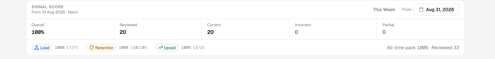
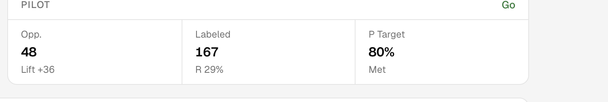

# Week 4 Shadow Mode — share-out

Internal. Paste this page into a partner note. You do not need Eval chrome.

## Claim

Human **keep-set Signal Score ≥80%** on the week window (reviews in that window ∩ keep-set). Bar is n≥5. This window: **Go**.

Labeled Detect precision/recall is **not** the claim.

## This window (logged 31 Aug 2026)

| | |
| --- | --- |
| Keep-set Signal Score | **1.00** (100%) |
| Reviews | **n=20** (20 correct / 0 incorrect / 0 partial) |
| Verdict | **Go** |
| Opportunities | 48 |
| Partner baseline | 12 |
| Lift | **+36** |
| Window Corrects Acted | 20/20 (display-only; nothing sent) |

Pinned Eval Metrics: From 31 Aug 2026 (`scoreFrom=2026-08-31T09:58:00.000Z`). A later empty window is **Insufficient Data** — it does not recycle this Go and is not a new one.

## Eval Metrics (pinned window)

Keep-set first. The Signal Score card is the win.

Lift vs the partner baseline of 12. **Labeled / R on this card is not the pilot win.**

## Not the claim

Eval → Labeled (and the Labeled / R figure on Pilot) is an internal pack metric. Do not quote labeled P/R as the week-4 result. A later window with a high labeled score and an empty keep-set is still **not** a Go.

## How to read a later window

- **Insufficient Data** — empty window or fewer than 5 reviews. Never recycle this Go. Never substitute labeled P/R.
- **Hold** — enough reviews, Signal Score below 80%. Continue Insights reviews. Not phrase-tuning, not outbound send.
- **Go** — n≥5 and keep-set Signal Score ≥80% in **that** window.

## Next step

Another **unused** weekly export (Week-5 or later), mid-week upsert (matching chats update; not a Day-1 replace). Not a week-3 re-ingest, not the held-out Batch-02 pack, not a Partner Demo wipe.

Shadow Mode stays review-only. Suggested actions are not sent.
