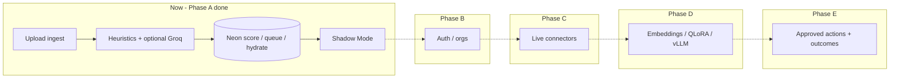

# Sioona — Company Construction File

**Updated:** 2026-08-16  
**Role:** Product north star + sequencing (not a week backlog).  
**Stack / blockers SoT:** [`.cursor/docs/PROJECT_STATE.md`](../docs/PROJECT_STATE.md)  
**Absorbed:** Grok NLP Report (SignalC1 / Sioona blueprint) — PDF retired; content lives here.

---

## 1. One-line product

**Sioona.ai** finds revenue signals (`lead`, `retention`, `upsell`) already in customer chats, surfaces them in **Shadow Mode** for human review, and proves lift vs the partner’s current process — **without replacing** Intercom / Zendesk / WhatsApp.

| | |
| --- | --- |
| Public brand | **Sioona.ai** |
| Tagline | **Signals into Revenue** |
| Internal engine | **SignalC1** (never in UI) |
| Category | Overlay conversation intelligence — not a chatbot, not Gong, not a CX agent swarm |
| Primary Detect wedge | **retention** (lead / upsell stay in taxonomy) |

---

## 2. North star (locked — do not reopen)

From the Grok blueprint, still true:

| Bet | Stance |
| --- | --- |
| Overlay, not replacement | Confirmed |
| Shadow Mode → human-approved actions → autonomy later | Confirmed |
| Open models + per-customer adaptation | Confirmed (privacy, cost, customization) |
| Privacy-first multi-tenant — no raw cross-tenant sharing | Confirmed |
| India pilots first, US finance later | Confirmed |
| Hybrid outcome pricing later (Insights volume → Autonomous base + outcomes) | Direction only — not near-term pitch |
| Full computer-use / agent swarm in early phases | **Rejected** |

**Vision workflow:**

```text
Chat sources → ingest → domain-adapted detect → score + summary
  → Insights / Shadow Mode ↔ human review
  → (later) approved actions → outcome feedback → model improvement
```

**Ultimate state (years, not this quarter):** a trusted digital teammate that understands the company’s conversation patterns and executes revenue work with human oversight on high-stakes actions.

**Core promise:** Detect high-confidence revenue opportunities in existing conversations and help act on them — measurable lift, low disruption.

---

## 3. Now (truthful vs hosted MVP)

Phase A — Insights Shadow Mode — is **built and hosted**. Do not rewrite this as “not built.”

| Layer | Current (shipped) | Later (do not start from this file) |
| --- | --- | --- |
| App | Next.js App Router, React 19, Tailwind, Geist (`web/`) | — |
| API | FastAPI Signal Score (`backend/`) | Auth0-gated multi-tenant API |
| Detect | Heuristics + optional Groq Qwen pass 2 (`detect-llm.ts`, `DETECT_LLM=1`) | vLLM / LangGraph / QLoRA |
| Domain adapt | Taxonomy overrides from SignalScore + Zerodha Adapt pack | Per-tenant continued pre-training / QLoRA |
| Data | JSON store for chats/taxonomy UI SoT; **Neon** for predictions, feedback, Acted, conversations/messages, `ground_truth`, pilot settings + hydrate | Full Neon chat SoT + taxonomy + pgvector |
| Auth | `X-Tenant-Id` (`tenant_demo`) | Auth0 |
| Ingest | File upload (CSV/JSON, Intercom, WhatsApp `.txt`) | Live webhooks |
| Hosting | Vercel `sioona-demo.vercel.app` + Render `sioona-api` + Neon | Starter plans if free sleep hurts |
| Autonomy | Shadow Mode only; suggested actions display-only; `acted` never sends outbound | Action Mode |

**Canonical loop today:**

```text
Upload export → ingest → detect (heuristics ⊕ optional LLM miss-pass ⊕ overrides)
  → Shadow Mode queue (Neon needs-review + join)
  → SignalScore → Adapt / Eval (keep-set ≥80% go) → Mark Acted (display)
```

**Pilot heading:** 2-week Shadow Mode; win = human keep-set SignalScore ≥80% on Eval week window. Week-1 / week-2 dry-runs on sioona-demo already logged go. Details and gates → `PROJECT_STATE.md`.

**Moat thesis unchanged; implementation order flipped:** prove value with the thinnest adapter that moves precision (heuristics → light LLM → embeddings → QLoRA only if eval proves a gap).

---

## 4. Past (collapsed)

What the Aug-9 brief treated as P0 / “Neon not yet” is largely done:

- Brand locked as Sioona.ai; SignalC1 internal
- Taxonomy + heuristic detect + Shadow Mode Insights + SignalScore + Eval / baseline lift
- Upload ingest (Intercom / WhatsApp / CSV/JSON); PII regex on ingest
- Pragmatic adaptation (overrides), not day-one GPU fine-tunes
- Hosted demo (Vercel) + FastAPI + Neon dual-write / hydrate / Acted / GT / pilot settings
- Detect v2 hybrid (optional Groq) — hosted verified
- Real-partner Adapt path + keep-set week-window Eval go dry-runs
- Marketing OS / partner demo script exist; GTM not blocked on brand docs

**Retired as operating truth:** “critical path = Auth0 + Neon + vLLM before first pilot,” navy/cyan UI SoT, live webhooks as MVP Must Have, fixture 100% P/R as a customer claim.

---

## 5. Future — Phase B → E (roadmap only; do not start from this file)

Infra follows precision and pilot renewal — not the reverse.

### Phase B — Design-partner production lite

Auth / real org isolation (Auth0 or equivalent), stronger tenant boundaries, audit log + retention controls, compliance pack for finance pilots, durable backups. Neon already holds score/queue/chat dual-write; finish the production tenancy story when concurrent pilots require it.

### Phase C — Live overlay

Intercom / WhatsApp (or wedge channel) webhooks, durable detect jobs, idempotent external IDs, rate limits / backpressure, PII redaction on the live path. Upload remains supported.

### Phase D — Model moat

Earn the report’s AI core: per-tenant embeddings (pgvector), API or self-hosted mid-size classify/summary, QLoRA only with labeled volume + privacy justification, vLLM when residency/cost demand it, LangGraph when multi-step approved actions exist.

### Phase E — Action Mode + autonomous tier

Human-approved API actions (CRM tag, note, notify) → outcome tracking linked to CRM truth → outcome fees only when attribution disputes are solvable. Computer-use / swarm stay explicit non-goals until trust + ROI are boring.



---

## 6. Operating rules

**Keep:** overlay; Shadow Mode before actions; HITL for high stakes; India-first sequencing; open-model direction; privacy multi-tenant; Geist / Vercel UI (not navy-cyan lore).

**Sell today:** one anonymized export → Shadow Mode → keep-set SignalScore (≥80% go) + lift vs baseline. No chatbot replacement. No autonomous actions. No outcome-fee pitch. Approve / Acted never send — partner runs follow-up outside.

**Do not build yet (unless explicitly asked):** Auth0, live webhooks, Action Mode outbound, pgvector / vLLM / QLoRA / LangGraph, taxonomy expansion to fake recall, outcome billing, on-prem, computer-use / swarm.

**GTM pack (shipped 2026-09-04):** vertical wedge (India broking/fintech CS, retention-first), pilot one-pager + anonymization/redaction checklist, LinkedIn 7-day ask + 2-week cadence, Eval go gate honesty, do-not-sell list — in [`PRODUCT.md`](../../PRODUCT.md) (Sell today) + [`PARTNER_DEMO.md`](../../PARTNER_DEMO.md). Not Phase B code.

---

## 7. Success criteria

| Layer | Metric | Gate |
| --- | --- | --- |
| Product | Keep-set review precision (Eval week window) | ≥80% go |
| Product | Lift vs partner baseline | Clear and documented |
| Product | Accepted signals that get human follow-up | Rising over pilot |
| GTM | Paid / committed pilots | 2–3 (sales goal, not a precision substitute) |
| Infra | Partner wipe + no raw cross-tenant share | Before serious paid scale |

**Biggest risk (unchanged from Grok):** trustworthy high-precision detection fast enough to convert and renew pilots. **Biggest unknown:** real-world WTP in India mid-market (report band ≈ ₹25k–90k/mo Insights — validate, don’t assume).

---

## 8. Related

[`PRODUCT.md`](../../PRODUCT.md) · [`PARTNER_DEMO.md`](../../PARTNER_DEMO.md) · [`README.md`](../../README.md) · [`PROJECT_STATE.md`](../docs/PROJECT_STATE.md) · [`.cursor/rules/sioona-product.mdc`](../rules/sioona-product.mdc) · [`.cursor/rules/sioona-architecture.mdc`](../rules/sioona-architecture.mdc)
