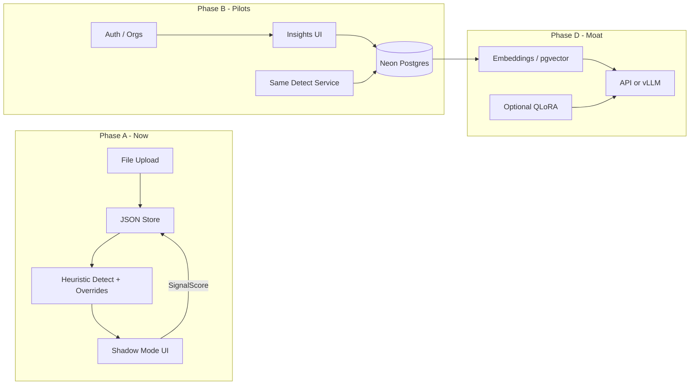

# Sioona Product Context — Infrastructure & GTM Brief

**Date:** 2026-08-09  
**Audience:** Founder + builders  
**Author stance:** Senior Infrastructure Engineer (pragmatic bootstrap path)  
**Primary sources:**

- `[Grok NLP Report.pdf](./Grok%20NLP%20Report.pdf)` — _SignalC1 / Sioona – Comprehensive Product Synthesis & Blueprint_ (image-only PDF; reconstructed below)
- Locked plan: `[.cursor/plans/sioona_product_context_6028d8b1.plan.md](./.cursor/plans/sioona_product_context_6028d8b1.plan.md)`
- Working product brief: `[PRODUCT.md](./PRODUCT.md)`
- Prior chats: [Grok NLP report review](3406b04f-9b61-48a5-b5a7-a3b2f2db3a14), [Project progress summary](8a87fa06-10d9-4d8a-87eb-23b936d4b9e4), [Codebase review next steps](b36c2e58-2ab3-44cf-8aa7-0e4fc4400560), marketing OS in `sioona-marketing/`

This document is the **teaching + operating brief** for how to build Sioona for real, what the Grok report got right, what to change now that Phase 1 code exists, and how to run GTM without waiting on heavy infra.

---

## 0. One-line product

**Sioona.ai** finds revenue signals (lead, retention/churn, upsell) already sitting in customer chats, surfaces them in **Shadow Mode** for human review, and proves lift vs the partner’s current process — **without replacing** Intercom / Zendesk / WhatsApp.

- Public brand: **Sioona.ai**
- Tagline: **Signals into Revenue**
- Internal engine name: **SignalC1** (never surface in UI)
- Category: **overlay conversation intelligence** — not a chatbot, not Gong, not a CX agent swarm

---

## 1. What the Grok NLP Report actually says

The report is a 12-page north-star blueprint. Treat it as **vision + sequencing**, not as a week-1 bill of materials.

### 1.1 Problem

Finance / high-chat teams have massive conversation volume. High-value moments (buy intent, churn risk, upsell readiness, sometimes fraud) are missed or found too late. Manual review does not scale. Generic AI and ticket tools optimize for deflection or post-hoc analytics, not **revenue-signal extraction with trust**.

### 1.2 Vision workflow (report)

```text
Chat sources
  → Ingestion
  → Preprocessing
  → Domain-adapted model (fine-tuned)
  → Signal heads + scoring + summary
  → Insights dashboard ↔ Human approval
  → Action execution (API / later computer-use)
  → Outcome feedback → model improvement
```

### 1.3 Confirmed bets (report)

| Bet                                            | Report stance                                                      |
| ---------------------------------------------- | ------------------------------------------------------------------ |
| Overlay, not replacement                       | Confirmed — lower adoption friction                                |
| Open models + per-customer fine-tuning         | Confirmed — privacy, cost, customization                           |
| Phased autonomy (Insights → actions)           | Confirmed — trust first                                            |
| Hybrid outcome pricing later                   | Confirmed direction (Insights volume → Autonomous base + outcomes) |
| India pilots first, US finance later           | Confirmed                                                          |
| Pure Sioona.ai public brand; SignalC1 internal | Strong recommendation                                              |
| Full computer-use / agent swarm in Phase 1     | **Rejected**                                                       |

### 1.4 Target stack (report — aspirational)

| Layer     | Report choice                                                                                     |
| --------- | ------------------------------------------------------------------------------------------------- |
| Ingestion | Webhooks/APIs (Intercom, Zendesk, WhatsApp, web chat)                                             |
| AI core   | Qwen3-30B-class + continued pre-training / QLoRA + vLLM + LangGraph                               |
| Data      | Neon Postgres + pgvector, tenant-isolated                                                         |
| Auth      | Auth0                                                                                             |
| UI        | Next.js Insights dashboard (report suggested dark navy + cyan; product UI SoT is now Geist/light) |
| Privacy   | No raw cross-tenant data sharing                                                                  |

### 1.5 MVP definition (report §12)

**Objective:** Prove domain-adapted signal detection on _real_ chats surfaces meaningfully more high-value opportunities than the customer’s current process, with enough accuracy to earn trust.

**MVP user:** Mid-market Indian finance or high-chat D2C, paid or heavily discounted pilot.

**MVP features:** ingestion, domain adaptation, core signals (leads + retention/upsell min), scoring/summaries, Insights dashboard, Shadow Mode, basic accuracy tracking.

**Not in MVP:** full autonomy, computer-use, hierarchical swarm, complex outcome billing, polished multi-agent personas, on-prem.

**Success criteria:**

- Precision on top signals ≈ **80%+** on reviewed samples
- Clear lift vs baseline opportunities found
- **2–3** paid/committed pilots
- Willingness to expand / upgrade

### 1.6 Report build order (§19)

1. Lock brand as Sioona.ai
2. Define initial signal taxonomy
3. Secure 2–3 design partners
4. Minimal chat ingestion (1–2 platforms)
5. Labeled eval set
6. Detection + scoring pipeline
7. Shadow Mode dashboard
8. Pilot metrics / offer
9. Multi-tenant + auth
10. First accuracy go/no-go tests

### 1.7 Biggest risks (report)

- Achievable precision/recall on real finance chat after adaptation
- India mid-market WTP (report cites ≈ ₹25k–90k/mo Insights)
- Historical data access / cleaning pain
- Fair, collectible outcome fees (later)

**Biggest technical risk (report):** trustworthy high-precision detection fast enough to convert pilots.

---

## 2. Where the codebase is today (honest stack)

Phase 0–1 Insights MVP **already exists** in `[web/](./web/)`. Do not rebuild foundations.

| Layer             | Current (shipped)                                                                                         | Report target (deferred)                                                      |
| ----------------- | --------------------------------------------------------------------------------------------------------- | ----------------------------------------------------------------------------- |
| App               | Next.js 15 App Router, React 19, Tailwind, **Geist light UI**                                             | Same app surface; navy/cyan was early prototype and was intentionally retired |
| Detect            | Keyword/phrase heuristics + hard negatives in `detect.ts` / `taxonomy.ts`                                 | Qwen3-30B + QLoRA + vLLM + LangGraph                                          |
| Domain adapt      | **Pragmatic:** store `taxonomyOverrides` from SignalScore reject / wrong_reason → re-detect               | Per-tenant continued pre-training / QLoRA                                     |
| Data              | JSON file store `web/data/store.json`                                                                     | Neon + pgvector                                                               |
| Auth              | None (demo tenant)                                                                                        | Auth0 multi-tenant                                                            |
| Ingest            | File upload: Sioona CSV/JSON, Intercom JSON, WhatsApp `.txt`                                              | Live webhooks                                                                 |
| Trust loop        | SignalScore (`accept` / `reject` / `wrong_reason`), Eval P/R, pilot baseline + lift, groundTruth labeling | EchoScore-style tracking (same idea; we named it SignalScore)                 |
| Demo / GTM assets | Demo Home, Start Partner Demo, `[PARTNER_DEMO.md](./PARTNER_DEMO.md)`, marketing OS                       |                                                                               |

**Canonical MVP loop in code:**

```text
Upload export
  → ingest (append conversations/messages)
  → detect (effective taxonomy = base ⊕ overrides)
  → Shadow Mode Insights queue
  → SignalScore feedback (preserved across re-detect)
  → Adapt From Reviews (overrides)
  → Eval (labeled + review precision, lift vs partner baseline)
```

This is the correct Phase 1 interpretation of the report’s “fine-tune / adapt” language for a bootstrap team: **adaptation = measurable feedback into detection**, not GPU training on day one.

---

## 3. Today’s takes on previous chats (2026-08-09)

### 3.1 From [Grok NLP report review](3406b04f-9b61-48a5-b5a7-a3b2f2db3a14)

That chat correctly tightened the report before treating it as build gospel. **Today I still stand by those high-impact changes**, and most of them are already reflected in product rules:

| Proposal from that chat                                                 | Today’s verdict                                                                                                                                                                                                                    |
| ----------------------------------------------------------------------- | ---------------------------------------------------------------------------------------------------------------------------------------------------------------------------------------------------------------------------------- |
| Narrow AI ambition: RAG / light adaptation first; QLoRA later           | **Keep.** We went further (heuristics + taxonomy overrides) — correct for speed-to-proof. Graduate to API LLM / RAG only when real-export precision plateaus.                                                                      |
| One primary signal for first pilot                                      | **Partially open.** Code supports three types; GTM should still **lead with one wedge signal** (recommend **retention/churn** for finance servicing, or **qualified lead** for broking acquisition) so demos tell one sharp story. |
| Product success = precision + actionability + follow-up; pilots are GTM | **Keep strongly.** Eval go/no-go ≥80% review precision is the product bar; “2–3 pilots” is sales.                                                                                                                                  |
| Flat Insights pilots; outcome fees Phase 2                              | **Keep.** Do not sell outcome billing yet.                                                                                                                                                                                         |
| Auth0 / hard multi-tenant after signal quality                          | **Keep.** Still not the critical path.                                                                                                                                                                                             |
| Lock primary ingest + always support upload                             | **Done** for upload path (Intercom + WhatsApp + CSV/JSON). Live webhooks stay deferred.                                                                                                                                            |
| Soften “autonomous OS / digital employee” externally                    | **Keep.** Marketing OS already frames overlay conversation intelligence.                                                                                                                                                           |
| Compliance as first-class (PII, retention, audit)                       | **Add next (lightweight).** Still thin in product; needed before serious finance pilots.                                                                                                                                           |
| India-first + pick a vertical wedge                                     | **Still open — decide this week.** Broking vs lending vs insurance servicing changes taxonomy language and outreach lists.                                                                                                         |

### 3.2 From [Project progress summary](8a87fa06-10d9-4d8a-87eb-23b936d4b9e4) + MVP gap closure

We correctly locked **pragmatic domain adaptation** (taxonomy overrides) instead of scaffolding QLoRA. Baseline lift, Adapt UI, and groundTruth labeling closed the main engineering gaps vs the report MVP wording.

**Today’s take:** engineering for the _demoable_ MVP is largely done. More feature code without real partner chats will not increase conviction.

### 3.3 From [Codebase review next steps](b36c2e58-2ab3-44cf-8aa7-0e4fc4400560)

Two truths from that thread both still apply:

1. **Cold path first:** practice `PARTNER_DEMO.md`, then get **one real support export**.
2. **Value before pilot ask:** detection must feel like “this finds money we miss,” not keyword bingo — deepen finance language, evidence quotes, suggested actions, missed-vs-found framing.

**Today’s synthesis:** run both in parallel for 14 days — tighten detection for the cold demo _and_ book outreach — but **do not** start Auth0/Neon/vLLM until one real export clears the precision gate (or clearly fails for reasons only an LLM can fix).

### 3.4 Marketing OS (Aug 6+)

`sioona-marketing/` already has positioning, outreach templates, LinkedIn/X cadence, and a soft pilot ask. **GTM is no longer blocked on brand docs.** It is blocked on (a) sharp vertical wedge, (b) calendar of outreach, (c) willingness to ask for anonymized exports.

---

## 4. What to keep / change / add (vs report + early plan)

### 4.1 Keep (do not reopen)

- Overlay architecture
- Shadow Mode before any actions
- Human-in-the-loop for high-stakes work
- Privacy-first; no raw cross-tenant sharing
- Rejection of chatbot replacement, computer-use, agent swarm in Phase 1
- Core loop: ingest → understand → detect → score → review → learn
- India-first pilot sequencing
- Public brand Sioona.ai / SignalC1 internal

### 4.2 Change (report → operating reality)

| Report language                                  | Change to                                                                                         |
| ------------------------------------------------ | ------------------------------------------------------------------------------------------------- |
| Qwen3-30B + QLoRA + vLLM as Phase 1 default      | **Heuristics → (optional) API LLM summarizer / classifier → RAG → QLoRA only if eval proves gap** |
| “Autonomous Conversation OS” as MVP messaging    | **Conversation intelligence / revenue signals**; autonomy is roadmap                              |
| Dark navy + cyan as UI SoT                       | **Geist / Vercel design principles, light product default** (already in rules)                    |
| Auth0 + Neon in MVP critical path                | **After** real-export precision + first paid pilot intent                                         |
| Live webhooks as Must Have for MVP               | **Export upload is the MVP ingest**; webhooks are Phase 1.5 / 2                                   |
| EchoScore suite                                  | **SignalScore** = accept / reject / wrong_reason only                                             |
| Hybrid outcome pricing “confirmed” for near-term | **Insights flat/volume pilot fee only** until attribution exists                                  |
| Broad India finance + D2C                        | **Pick one wedge vertical for first 2–3 pilots**                                                  |

### 4.3 Add (missing or under-built for GTM)

1. **Lightweight compliance pack for pilots**

- Anonymized-export guidance for partners
- Retention policy (how long we keep their chats)
- Simple audit log: who reviewed which signal
- Optional PII redaction pass on ingest (phone/email/PAN-like patterns)

2. **Pilot commercial kit (one page)**

- 2-week Shadow Mode offer
- Price band (anchor from report ₹25k–90k/mo, or discounted design-partner rate)
- Success metrics: review precision, lift vs baseline, # signals acted on manually
- Explicit non-promises (no webhooks, no autonomy, no outcome fees)

3. **Wedge decision + ICP list of 30**

- Choose broking / lending / insurance servicing / fintech CS
- Name 30 accounts + 1–2 champion roles (Head of CX, Support Ops, Revenue Ops)

4. **Hosted demo environment**

- Deploy `web/` to Vercel (or similar) with a **resettable demo tenant**
- Cold demos should not depend on localhost

5. **Real eval corpus**

- 50–200 labeled conversations from one partner (or scraped anonymized samples if legal)
- Fixture 100% P/R is not evidence

6. **Detection quality bar for cold demos**

- India finance lexicon depth (demat, SIP, KYC, charges, account closure, premium advisory)
- Hard negatives for ops/polite language
- Evidence = customer quotes, not only `phrase:"…"` labels

7. **Optional Phase 1.5 AI upgrade path (only if heuristics fail on real data)**

- API model for summary + suggested action (display-only)
- Small classifier / embedding similarity over taxonomy examples
- Still no vLLM cluster until unit economics and privacy story demand it

---

## 5. How to build this product — infrastructure teaching

Think in **layers of proof**, not layers of cloud.

### 5.1 Principle: infra follows precision

```text
Prove signal quality on files
  → Prove partner trust in Shadow Mode
  → Then harden tenancy, auth, storage
  → Then live ingestion
  → Then model serving / fine-tune
  → Then actions + outcome attribution
```

Spending early cycles on Auth0 + Neon + GPU is classic premature infrastructure. The report’s stack is a **Phase 2–3 target architecture**, not the critical path to first revenue.

### 5.2 Recommended phase model (updated)

#### Phase A — Insights Shadow Mode (NOW — mostly built)

**Goal:** Trustworthy detection + review loop on exports.

| Component             | Build         | Notes                                  |
| --------------------- | ------------- | -------------------------------------- |
| Upload ingest         | Done          | Intercom / WhatsApp / CSV/JSON         |
| Taxonomy + detect     | Done / deepen | Finance lexicon + negatives            |
| Insights queue        | Done          | Prioritized 10–20 signals first screen |
| SignalScore           | Done          | Keep simple                            |
| Eval + baseline lift  | Done          | Partner sets baseline                  |
| Pragmatic adapt       | Done          | Overrides → re-detect                  |
| Hosted demo           | **Add**       | Vercel + sample reset                  |
| Pilot compliance lite | **Add**       | Retention + anonymize guide            |
| Tests                 | Done          | Vitest on detect/ingest/eval/demo      |

**Data plane:** single-tenant JSON store is fine for design partners if you:

- keep one partner per deployed environment or isolated store file
- do not train on their data without written permission
- delete/export on request

**Exit criteria:** ≥80% review precision on a real export (or clear documented failure mode), and a partner who will do weekly reviews for 2 weeks.

#### Phase B — Design-partner production lite (after first real export clears)

**Goal:** Run 2–3 pilots without reinventing SaaS.

| Component     | Choice                                  | Why                                               |
| ------------- | --------------------------------------- | ------------------------------------------------- |
| Hosting       | Vercel (app)                            | Matches Next.js; fast                             |
| DB            | Neon Postgres (single region first)     | Replace JSON when concurrent pilots / size bite   |
| Blob          | optional object storage for raw exports | Keep originals out of git / local disk            |
| Auth          | Auth0 or Clerk **simple org login**     | Only when second concurrent pilot needs isolation |
| Secrets       | env + restricted access                 | No partner data in repo                           |
| Observability | basic request logs + error tracking     | Enough for 3 pilots                               |
| Backups       | Neon PITR / nightly export              | Finance buyers will ask                           |

Schema sketch (when leaving JSON):

```text
tenants
conversations (tenant_id, channel, external_id, ground_truth)
messages (conversation_id, role, content, ts)
signals (conversation_id, type, score, summary, evidence jsonb, status)
signal_feedback (signal_id, label, note, reviewed_at, reviewer)
taxonomy_overrides (tenant_id, type, phrases[], keywords[], negatives[])
pilot_settings (tenant_id, baseline_opportunities, note)
audit_events (tenant_id, actor, action, entity_id, ts)
```

**Still out:** pgvector until you actually do embeddings; LangGraph until you have action workflows.

#### Phase C — Live overlay (only after pilots renew / expand)

| Component                  | Choice                                                                            |
| -------------------------- | --------------------------------------------------------------------------------- |
| Ingest                     | Intercom webhook + WhatsApp Business Cloud API (pick the channel your wedge uses) |
| Queue                      | durable job queue for detect (don’t block request path)                           |
| Idempotency                | external conversation/message IDs                                                 |
| Rate limits / backpressure | required for chat volume                                                          |
| PII redaction              | on ingest path before store                                                       |

#### Phase D — Model moat (report’s AI core — earn it)

Only when Phase A–C show that heuristics + light LLM still miss measurable revenue:

1. Embedding index per tenant (pgvector) over historical chats / examples
2. API or self-hosted mid-size model for classification + summary
3. Per-tenant QLoRA **if** labeled volume and privacy justify training ops
4. vLLM when self-host latency/cost beats API **and** data residency requires it
5. LangGraph when multi-step approved actions exist

**Moat thesis stays:** deep per-customer adaptation. **Implementation order flips:** prove value with the thinnest adapter that moves precision.

#### Phase E — Actions + autonomous tier (report Phase 2–3)

- Human-approved API actions (CRM tag, note, notify)
- Outcome tracking linked to CRM truth
- Outcome fees only after attribution disputes are solvable
- Computer-use / swarm remain explicit non-goals until trust + ROI are boring

### 5.3 Architecture diagram (bootstrap → target)



### 5.4 Reliability & security checklist (finance-ready enough for pilots)

**Must before paid pilots:**

- Written data processing note (what you store, how long, who accesses)
- Separate demo data from partner data
- No partner exports in git
- HTTPS hosted app
- Ability to wipe a tenant on request

**Should soon after first paid pilot:**

- Audit log of reviews
- Role separation (viewer vs reviewer)
- Encrypted backups
- Basic SOC2-minded practices (access control, logging) — not a full SOC2 project yet

**Must not do early:**

- Train a shared model on raw multi-tenant chats
- Promise on-prem or VPC peering in the first pilot contract
- Put API keys or partner files in the marketing repo

### 5.5 Cost control (infra lens)

| Stage                               | Expected monthly burn (order of magnitude) | Notes                       |
| ----------------------------------- | ------------------------------------------ | --------------------------- |
| Phase A localhost / Vercel hobby    | ≈ $0–20                                    | Dominated by your time      |
| Phase B 2–3 pilots on Neon + Vercel | ≈ $20–150                                  | Still founder-cheap         |
| API LLM assist on summaries         | usage-based                                | Cap tokens; cache summaries |
| Self-hosted 30B + GPUs              | **$ hundreds–thousands**                   | Do not start here           |

The report’s 30B-class real-time inference risk is real. Avoid paying that tuition until precision ROI is proven.

### 5.6 How an infra engineer would staff the work

Solo / tiny team order of leverage:

1. **Detection quality + eval discipline** (product truth)
2. **Hosted demo + pilot kit** (sales truth)
3. **Partner data hygiene** (trust truth)
4. **DB + auth** (scale truth)
5. **Live connectors** (distribution truth)
6. **Training / serving stack** (moat truth)

If you ever hire the first infra/platform person, their first job is **tenant isolation + export lifecycle + audit**, not Kubernetes for vLLM.

---

## 6. GTM ASAP — how to sell this before the heavy stack exists

### 6.1 The only offer that matches the product today

> Send one anonymized Intercom or WhatsApp export.  
> We’ll run Shadow Mode, score lead / retention / upsell signals, and show opportunity lift + review precision vs your current process.  
> No integration. No chatbot replacement. No autonomous actions.

That sentence is your GTM. Everything else is decoration.

### 6.2 Wedge (decide this week)

Pick **one** primary narrative:

| Wedge                   | Primary signal               | Why it works                                   |
| ----------------------- | ---------------------------- | ---------------------------------------------- |
| **Broking / wealth**    | Qualified lead + retention   | Fee/plan questions + “close account” are crisp |
| **Lending / NBFC**      | Retention / collections risk | High chat volume; clear save moments           |
| **Insurance servicing** | Retention + upsell           | Policy lapse + rider upgrades                  |
| **Fintech CS**          | Lead + retention             | Fast movers; shorter sales cycle               |

**Recommendation:** broking/wealth **or** lending — whichever network you can get 10 warm intros into fastest. Do not pitch “all of finance + D2C” in the first 20 outreaches.

### 6.3 14-day GTM sprint

**Days 1–2 — Package**

- Deploy hosted demo with **Start Partner Demo**
- One-pager PDF: problem → Shadow Mode → proof metrics → 2-week pilot → price
- Anonymization instructions (strip phone/email/account numbers before send)
- Practice the 5-minute script in `[PARTNER_DEMO.md](./PARTNER_DEMO.md)` until muscle memory

**Days 3–7 — Pipeline**

- List 30 ICP accounts + champions
- Send 15 personalized notes/day (use `sioona-marketing/pilots/outreach-messages.md`)
- Publish the already-drafted LinkedIn soft pilot ask
- Goal: **10 conversations booked**, not 10 likes

**Days 8–14 — Proof**

- Run cold demos aggressively
- Convert ≥3 to “send export”
- On first real export: ≥5 SignalScore reviews, set baseline, Adapt once, re-eval
- Ask for **2-week Shadow Mode pilot** (weekly export + 30-min joint review)

### 6.4 Pilot design (commercial)

| Term    | Suggestion                                                                                          |
| ------- | --------------------------------------------------------------------------------------------------- |
| Length  | 2 weeks (extend to 4 if engaged)                                                                    |
| Price   | Design-partner discount now; publish list later (report band ₹25k–90k/mo Insights)                  |
| Inputs  | Weekly export OR secure upload link                                                                 |
| Cadence | 2× 30-min review calls / week                                                                       |
| Success | Review precision ≥80% on reviewed sample **or** clear lift vs baseline + champion wants to continue |
| Exit    | Paid Insights month, or documented learnings (no fake vanity case study)                            |

### 6.5 Sales anti-patterns (kill these)

- Demoing Auth0 / multi-tenant / “we’ll fine-tune a 30B model” before signals feel smart
- Promising live WhatsApp webhooks on the first call
- Leading with “autonomous digital employee” to a compliance-sensitive buyer
- Using fixture 100% precision as a customer-facing claim
- Building a polished marketing site instead of taking meetings (report §17 agrees)

### 6.6 Messaging that matches infrastructure reality

**Use:**

- Overlay conversation intelligence
- Shadow Mode / proof before integration
- Signals into Revenue
- Lift vs your current process

**Avoid externally for now:**

- Autonomous OS
- Computer-use
- Outcome fees as the pitch
- SignalC1 branding

### 6.7 What “GTM ASAP” does _not_ require

- Neon
- Auth0
- vLLM / QLoRA / LangGraph
- Outcome billing engine
- On-prem
- Perfect website

It **does** require: hosted demo, sharp wedge, 30-account list, ask for exports, and ruthless eval honesty.

---

## 7. Success criteria — separate product proof from sales proof

| Layer   | Metric                                         | Gate                                           |
| ------- | ---------------------------------------------- | ---------------------------------------------- |
| Product | Review precision on partner-reviewed signals   | ≥80% go / below = Adapt or no-sell             |
| Product | Labeled P/R on held-out chats                  | Track; improve weekly                          |
| Product | Time-to-decision on a signal card              | Seconds, not minutes                           |
| Product | % of accepted signals that get human follow-up | Rising over pilot                              |
| GTM     | Design-partner conversations / week            | ≥5 in sprint                                   |
| GTM     | Exports received                               | ≥3 in first month                              |
| GTM     | Paid or committed pilots                       | 2–3 (sales goal, not substitute for precision) |
| Infra   | Partner data wipe works                        | Before invoice #1                              |

---

## 8. Immediate backlog (ordered)

### P0 — this week

1. Decide **vertical wedge** + **primary signal** for first pilots
2. Deploy hosted demo (resettable)
3. Pilot one-pager + anonymization guide
4. 30-account outreach list + start sending
5. Deepen taxonomy for that wedge; re-run cold demo until it feels valuable

### P1 — as soon as first export arrives

1. Label 50+ conversations (`groundTruth`)
2. SignalScore pass + Adapt overrides + re-detect
3. Record precision / lift honestly; write internal go/no-go note
4. Convert to 2-week pilot or document why not

### P2 — only after pilot #1 is real

1. Neon + basic auth isolation
2. Audit log + retention controls
3. Live connector for the channel that won the pilot
4. Optional API-LLM summaries if humans say “evidence/summary is weak”

### Explicitly later (report Phase 2–3)

- QLoRA / vLLM / LangGraph
- Outcome fees
- Computer-use / swarm
- US enterprise motion
- On-prem

---

## 9. Open decisions still needed from you

Reply with choices so this brief can be narrowed further:

1. **Primary MVP signal for outreach:** retention/churn, qualified lead, or upsell?
2. **Vertical wedge:** broking/wealth, lending/NBFC, insurance, or fintech CS?
3. **Primary channel story:** WhatsApp, Intercom, Zendesk, or “upload-first, channel-agnostic”?
4. **Design-partner price:** free for data, discounted INR monthly, or full Insights band?
5. **Hosted demo:** deploy now to Vercel under sioona.ai (or subdomain)?

---

## 10. Final operating thesis (2026-08-09)

The Grok NLP Report is still the right **north star**: overlay, domain adaptation, Shadow Mode, India-first, open models, privacy-first multi-tenant, autonomy later.

What changed with real code and prior reviews:

- **Phase 1 adaptation = taxonomy feedback loop**, not GPU fine-tunes
- **UI SoT = Geist light**, not navy/cyan lore
- **Critical path = real exports + precision + meetings**, not Auth0/Neon/vLLM
- **GTM ASAP = one-export Shadow Mode offer** with a vertical wedge and a hosted demo

If you only do three things next:

1. **Pick the wedge.**
2. **Host the demo and run outreach.**
3. **Get one real export through Eval with brutal honesty.**

Everything in the report’s glamorous AI stack becomes cheaper and clearer after those three.

---

_Related docs:_ `[PRODUCT.md](./PRODUCT.md)` · `[PARTNER_DEMO.md](./PARTNER_DEMO.md)` · `[README.md](./README.md)` · `[.cursor/rules/sioona-product.mdc](./.cursor/rules/sioona-product.mdc)` · `[.cursor/rules/sioona-architecture.mdc](./.cursor/rules/sioona-architecture.mdc)`
