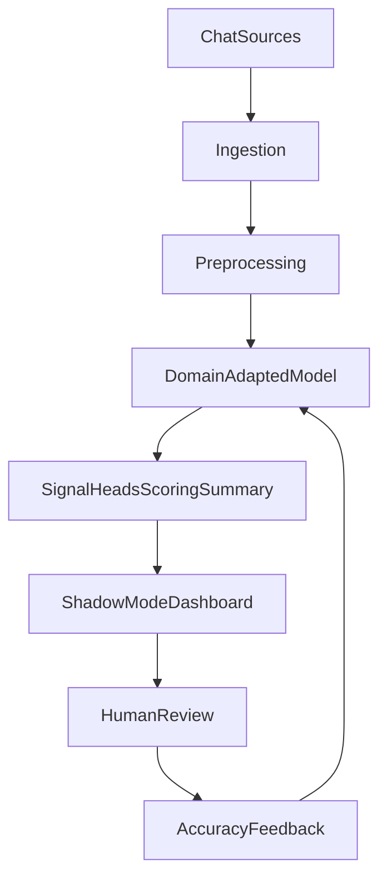

# Sioona Product Context (from Grok NLP Report)

Primary source: [Grok NLP Report.pdf](/Users/sanket/Documents/Sioona/Grok%20NLP%20Report.pdf) — _SignalC1 / Sioona – Comprehensive Product Synthesis & Blueprint_.

## What we are building

**Sioona.ai** — an Autonomous Conversation Operating System that sits on top of existing chat tools, detects high-value revenue signals in real time, and eventually acts on them. Public brand: **Sioona.ai**. Internal engine name: **SignalC1**. Tagline: **Signals into Revenue**.

Core promise: find hidden revenue in conversations customers already have — leads, retention/churn, upsell — without replacing Intercom/Zendesk/WhatsApp/etc.

## Confirmed product bets

- **Overlay, not replacement** — lower adoption friction
- **Open models + per-customer domain adaptation** (Qwen3-30B-class, continued pre-training / QLoRA, vLLM, LangGraph)
- **Phased autonomy** — Insights/Shadow Mode first; human-approved actions later; computer-use/swarm later still
- **Privacy-first multi-tenant** — Neon Postgres + pgvector, Auth0, no raw cross-tenant data
- **Hybrid pricing later** — Insights (volume subscription) → Autonomous (base + outcome fees)
- **GTM** — India finance / high-chat D2C pilots first; US finance later

## Phase 1 MVP (what to prove)

Prove domain-adapted signal detection beats the customer’s current process, with enough precision to earn trust.

MVP loop:

**In MVP:** ingestion (1–2 platforms), domain adaptation, core signals (retention + upsell/lead min), scoring/summaries, Insights dashboard, Shadow Mode, basic SignalScore-style accuracy tracking, multi-tenant auth foundation.

**Not in MVP:** full autonomy, computer-use, hierarchical agent swarm, complex outcome billing, on-prem, heavy Dune branding, chatbot replacement.

## Target stack (from report)

| Layer     | Choice                                                                           |
| --------- | -------------------------------------------------------------------------------- |
| Ingestion | Webhooks/APIs (Intercom, Zendesk, WhatsApp, web chat)                            |
| AI core   | Open model + QLoRA + vLLM + LangGraph                                            |
| Data      | Neon Postgres + pgvector (tenant-isolated)                                       |
| Auth      | Auth0                                                                            |
| UI        | Next.js Insights dashboard (desktop-first; dark navy + cyan; calm/authoritative) |

## Success criteria (MVP)

- High precision on top signals (report cites ~80%+ on reviewed samples as a target)
- Clear increase in identified opportunities vs baseline
- 2–3 paid/committed pilots
- Willingness to expand / upgrade

## Biggest risks / open questions

- Achievable precision/recall on real finance chat after fine-tuning
- India mid-market WTP (₹25k–90k/mo Insights)
- Historical data access/cleaning pain
- Fair, collectible outcome fees (later)

## Immediate next steps from the report (build order)

1. Lock brand as Sioona.ai (done directionally)
2. Define initial signal taxonomy
3. Secure 2–3 design partners
4. Minimal chat ingestion for 1–2 platforms
5. Labeled eval set
6. Detection + scoring pipeline
7. Shadow Mode dashboard
8. Pilot metrics/offer
9. Multi-tenant + auth
10. First accuracy go/no-go tests

## Workspace status

Phase 1 Insights MVP lives in [`web/`](/Users/sanket/Documents/Sioona/web): ingest (Sioona CSV/JSON + Intercom JSON + WhatsApp txt) → heuristic detect → Shadow Mode queue → SignalScore feedback → eval/pilot metrics. Product brief: [`PRODUCT.md`](/Users/sanket/Documents/Sioona/PRODUCT.md). Auth0 / Neon / LLM scaffolds remain deferred until precision on real chats justifies them.
